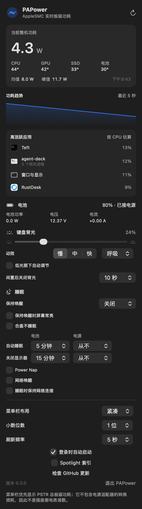

# PAPower

PAPower 是一个原生 macOS 菜单栏功耗监控原型。它会把当前功耗直接显示成
`12.4W` 这样的菜单栏文字，点击后可以查看短期趋势、高活跃应用、CPU／GPU／SSD／电池温度，
以及电池功率、电压和电流。

<p align="center">
  
</p>

## 数据含义

- 菜单栏优先读取 AppleSMC 的 `PSTR`，表示 Mac 的总板级功耗（Total Board Power）。
- 电池详情来自 IOKit / AppleSmartBattery，电池功率按 `电压 × 电流` 计算。
- CPU、GPU 和 SSD 温度优先从 IOKit/HID 温区读取，并显示当前可识别温区中的最高有效值；
  AppleSMC 传感器键作为兼容回退。不同芯片和 macOS 版本提供的温区可能不同，缺失时会显示 `—`。
- 如果 `PSTR` 不可用且 Mac 正在使用电池，PAPower 会明确切换为“电池端估算值”。
- `PSTR` 不是插座侧功率，不包含电源适配器的转换损耗。需要精确测量墙上取电时，应使用 USB-C 或插座功率计。
- macOS 不提供可靠的逐应用瓦数。弹窗中的“高活跃应用”会合并同一应用的 Helper 进程，并按近期 CPU 活跃度提供排查线索；它不是功率分摊结果。

所有功耗采样均在本机完成，不需要管理员权限，也不会上传数据。只有用户主动点击
“检查 GitHub 更新”时，应用才会访问 GitHub Releases 查询最新版本。

## Spotlight 索引开关

面板中的“Spotlight 索引”开关用 `mdutil -a -i on|off` 打开或关闭所有卷的 Spotlight 索引，
用来减少 `mds_stores` 在后台建索引的耗电。状态读取自 `mdutil -s /System/Volumes/Data`，
不需要权限；切换时会弹出系统管理员密码框。关闭后 ⌘空格、Finder 和邮件搜索
都无法再按内容找到新文件，重新打开后 macOS 会重建索引，期间会有一段较高的后台占用。

## 键盘背光

面板中的“键盘背光”可直接调节内建键盘亮度、开关“低光照下自动调节”，并设置闲置多久后关闭背光，
与系统设置和键盘亮度键同步。它通过 CoreBrightness 私有框架的 `KeyboardBrightnessClient` 实现，
不需要权限；该接口不保证跨系统版本稳定，找不到时此区块会自动隐藏。

亮度调到 0 后系统会把背光标记为关闭；开着自动调节时单独设亮度清不掉这个标记，
因此面板会先短暂关闭自动调节、设好亮度，约 0.5 秒后再恢复自动调节。
显示的百分比是当前生效亮度，背光关闭或闲置熄灭时显示为 0%。

“动效”默认开启呼吸，提供呼吸、心跳、闪烁和烛光四种效果，可选慢／中／快三档节奏，亮度滑块决定动效最亮的程度。
每个关键帧只发一次带渐变时长的亮度请求，由系统完成平滑过渡；实测呼吸动效让 PAPower 与
`corebrightnessd` 各多占约 0.1% CPU。动效运行时会暂停闲置熄灭，屏幕休眠、系统睡眠、切换用户或合盖时
自动暂停；关闭动效或退出应用时写回原亮度。动效选择会被记住，下次启动继续；若应用异常退出，
下次启动会先补做亮度恢复。

## 睡眠

面板中的“睡眠”区块集中管理睡眠相关设置：

- **保持唤醒**：可选 30 分钟到 4 小时或一直保持，用电源断言阻止系统闲置睡眠（与 `caffeinate` 相同），
  可同时让屏幕常亮。不需要权限，到期或退出 PAPower 后自动失效；它不阻止合盖睡眠。
- **合盖不睡眠**：切换 `pmset -a disablesleep`，合盖和闲置都不会睡眠。这是系统级设置，退出 PAPower 后仍然有效，
  开启期间面板会持续提醒；切换需要管理员密码。
- **自动睡眠与关闭显示器时间**：分电池和电源设置，对应 `pmset -b|-c sleep / displaysleep`。
- **睡眠后台活动**：Power Nap、网络唤醒和睡眠时保持网络连接，对应 `powernap`、`womp`、`tcpkeepalive`，
  电池和电源下一起设置；关闭可减少睡眠期间的耗电。

自动睡眠时间和后台活动先在面板里编辑，点“应用更改”后合并成一条 `pmset` 命令，只弹一次管理员密码框。
设置读取自 `pmset -g custom`，本机不支持的项目（如台式机的电池设置）不会显示。

## 从 GitHub 更新

在菜单栏弹窗中点击“检查 GitHub 更新”，PAPower 会读取
[`Kymorphius/PAPower` 的最新 Release](https://github.com/Kymorphius/PAPower/releases/latest)
并与当前版本比较。发现新版本后，点击“前往下载”即可打开对应的 Release 页面。

应用不会在后台自动检查或自动安装更新。

## 构建和运行

要求 macOS 13 或更高版本，以及完整安装的 Xcode。

```bash
./Scripts/build-app.sh
open dist/PAPower.app
```

构建产物位于 `dist/PAPower.app`。要长期使用，可以把它拖到“应用程序”文件夹。首次启动时会默认开启“登录时自动启动”，
之后可在弹出面板里关闭，关闭后不会再被自动打开。

读取一次数据并输出 JSON（便于调试）：

```bash
dist/PAPower.app/Contents/MacOS/PAPower --probe
```

读取一次高活跃应用列表：

```bash
dist/PAPower.app/Contents/MacOS/PAPower --activity-probe
```

读取原始温度传感器，便于核对新机型：

```bash
dist/PAPower.app/Contents/MacOS/PAPower --temperature-probe
```

用真实数据生成完整展开的面板截图（约 8 秒，README 中的截图即由此生成）：

```bash
dist/PAPower.app/Contents/MacOS/PAPower --panel-snapshot docs/panel.png
```

## 技术与分发边界

菜单栏和电池状态使用 Apple 的公开 macOS 框架。`PSTR` 功耗键以及 CPU／GPU／SSD 温区读取
依赖未公开承诺稳定性的 AppleSMC 或 IOKit 接口；它们在 Apple Silicon Mac 上很实用，
但未来系统或不同机型可能改变。
因此当前版本更适合 Developer ID 直签分发，不应在未验证 App Sandbox 与审核政策前直接按
Mac App Store 方案发布。

本项目只参考 AlDente 的公开产品行为，没有使用或逆向其私有源码。
